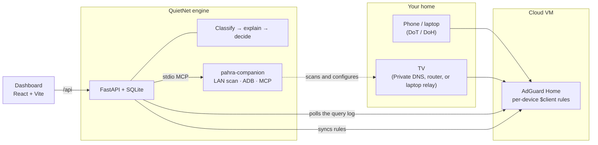

<p align="center"></p>

<h3 align="center">See which companies your TV, phone and laptop talk to, and silence the ones you don't want.</h3>

<p align="center">
  <a href="https://github.com/ARahhul/QuietNet/actions/workflows/ci.yml"></a>
  
  
  
  
  
  <a href="https://quietnet.in"></a>
</p>

<p align="center">
  <a href="#what-it-does">Features</a> ·
  <a href="#how-it-works">How it works</a> ·
  <a href="#quick-start">Quick start</a> ·
  <a href="#connect-my-tv">Connect my TV</a> ·
  <a href="#privacy">Privacy</a> ·
  <a href="CONTRIBUTING.md">Contributing</a>
</p>

---

Smart TVs, phones and apps phone home constantly. Most people never see it, and the few tools that show it (Pi-hole, a router's DNS log) need a Raspberry Pi, a free evening and a lot of patience.

**QuietNet is a cloud DNS gateway for the home.** Every device resolves through an [AdGuard Home](https://github.com/AdguardTeam/AdGuardHome) server on a VM. On top of it, QuietNet's engine reads the query log, works out *who* each domain belongs to, explains it in plain language, and lets you block it for one device at a time. It even finds your TV on the WiFi and points its DNS at QuietNet for you.

Nothing to install on the devices, and no hardware at home.

## What it does

| | |
|---|---|
| **Explains every lookup** | Each tracker, ad network and telemetry domain becomes a card: who owns it, what it collects, how sure QuietNet is, and why. Lists, DuckDuckGo Tracker Radar, RDAP and an LLM are combined, and the LLM only ever sees the domain name |
| **Blocks per device** | Block all ads and trackers for the living-room TV without touching your phone. Every rule carries a `$client`, so devices are isolated from each other, and **Undo** is one click |
| **Connects your TV for you** | The *Connect my TV* assistant scans the WiFi, fingerprints the TV, and sets Private DNS over ADB (Android TV, Google TV, Fire TV). For locked TVs (LG webOS, Samsung Tizen) it runs a DNS relay on your laptop, even behind CGNAT |
| **Live lookups and a blocked list** | A Pi-hole style view of what every device is asking for, right now, and what QuietNet stopped |
| **Weekly report and alerts** | Which devices are chattiest and which companies get the most lookups, plus security and privacy alerts with steps to fix the source |
| **"Site or app not working?"** | Name the site, or paste a screenshot of it failing. QuietNet finds what it blocked around then and lets it through, for the home or one device, and that can be undone too |
| **"Saw an ad?"** | Say where and when you saw ads, and QuietNet picks the lookups that most likely served them, including an app's own ad servers that lists miss. Nothing is blocked until you choose |
| **Home WiFi setup for any provider** | Detects your ISP from your IP and shows the exact steps to set DNS, with an AI-written guide for providers it doesn't know yet, and a screenshot helper when you get stuck |
| **Per-home accounts** | Sign in with Google; every person sees only their own devices. Per-account rate limits protect the API and the AI features |
| **Works without an AI key** | Without a Gemini or OpenAI-compatible key, cards use list text and the TV assistant runs the same playbook deterministically |

## How it works



1. **Resolve.** Each device gets its own address (`<client-id>.dns.<domain>`), so QuietNet always knows *which* device asked.
2. **Classify.** The engine polls AdGuard's query log and runs each new domain through a pipeline: blocklists, seed data, tracker radar, RDAP, then an optional LLM for the explanation.
3. **Decide.** You get a suggestion card, or turn on auto-mode. Decisions become AdGuard rules scoped to that one device.
4. **Reverse.** Every decision can be undone, and rule sync is idempotent.

### Repository layout

| Folder | What |
|---|---|
| [`backend/`](backend) | The engine: poller, domain pipeline, decisions, rule sync, REST API, AI assistant. Python, FastAPI, SQLite |
| [`frontend/`](frontend) | The dashboard and the public homepage: setup wizard, suggestions, devices, live lookups, report, settings. React, TypeScript, Vite, Tailwind |
| [`companion/`](companion) | `pahra-companion`, an MCP server that scans the LAN, fingerprints TVs, talks ADB and runs the DNS relay. See [companion/README.md](companion/README.md) |
| [`infra/`](infra) | VM setup: AdGuard in Docker, wildcard certificate, hardening, SSH tunnel, Azure deploy. See [infra/README.md](infra/README.md) |
| [`scripts/`](scripts) | `dev.ps1` opens everything in separate windows, `reset-demo.ps1` resets demo data |
| [`DEMO.md`](DEMO.md) | A three-minute demo runbook |

## Quick start

You need Python 3.11+, [Poetry](https://python-poetry.org/) 2 (`pipx install poetry`) and Node 20+. No VM is required to try it: a fake AdGuard generates TV and phone traffic for every device you add.

After installing once (below), one command opens everything in separate windows:

```powershell
.\scripts\dev.ps1                          # local: fake AdGuard + API + dashboard (no VM needed)
.\scripts\dev.ps1 -Real -VmHost <VM_IP>    # real: SSH tunnel + API (backend\.env) + dashboard
```

### Run locally, step by step

Each block runs in its own terminal. Python dependencies are managed with Poetry: `backend/` and `companion/` each have a `pyproject.toml` and a committed `poetry.lock`, and `poetry install` makes a `.venv` inside that folder (`poetry.toml`), which the scripts rely on. To change a dependency, run `poetry add <pkg>` or `poetry update <pkg>` and commit both files.

**Backend:**

```powershell
cd backend
poetry install
copy .env.example .env      # then set ADGUARD_URL=http://127.0.0.1:3100 for the fake
```

**Fake AdGuard:**

```powershell
cd backend
poetry run python -m devtools.fake_adguard --port 3100
```

**API.** It spawns the companion automatically if `companion\.venv` exists:

```powershell
cd backend
poetry run uvicorn pahra.main:create_app --factory --port 8000
```

**Companion.** The TV assistant needs it:

```powershell
cd companion
poetry install
winget install Google.PlatformTools   # adb, for Android / Google / Fire TV automation
```

**Dashboard:**

```powershell
cd frontend
npm install
npm run dev                  # http://localhost:5173  (proxies /api to :8000)
```

### Try it

1. Add a device in **Setup**.
2. Within a poll cycle (30 s), cards appear in **Suggestions**.
3. Choose **Block all ads & trackers**. In the fake, that device's queries now return NXDOMAIN.
4. Choose **Undo** to reverse it.

### Go real

* **Cloud DNS server:** step by step in [infra/README.md](infra/README.md). Run `infra\tunnel.ps1` and keep `ADGUARD_URL=http://127.0.0.1:3000`, or run the whole engine on the VM so the dashboard works with the laptop off.
* **Settings:** every option is documented in [`backend/.env.example`](backend/.env.example).
* **Presenting:** [DEMO.md](DEMO.md). With `GEMINI_API_KEY` set, run `poetry run python -m devtools.prewarm` in `backend` first. It caches explanations for the demo devices' domains, so cards never wait on the model. It never blocks anything.

## Connect my TV

**Setup → TV** opens the assistant. Describe the TV ("the LG in the living room") and it does the following:

1. Reads the network context: gateway, router brand, and the CGNAT verdict.
2. Scans the WiFi and lets you pick the TV.
3. Pings and probes the TV you picked.
4. **Android TV, Google TV or Fire TV:**
   1. Walks you through turning on ADB, or pairs over Wireless debugging.
   2. Asks before each change.
   3. Creates the QuietNet device and sets Private DNS to `<client-id>.dns.<domain>`.
   4. Waits for the TV's first query in AdGuard and shows **Connected**.
5. **Locked TVs behind CGNAT** (LG webOS, Samsung Tizen), or when ADB is refused:
   1. It offers the **laptop DNS relay** and asks first.
   2. The companion listens on the laptop's WiFi IP:53 and forwards each TV's queries over DoH under that TV's own ClientID.
   3. You type the laptop's IP into the TV's DNS. QuietNet waits for the first query and shows **Connected**.
   4. The relay is restored whenever the backend starts, and stops for a TV when you delete that TV.
   5. The laptop has to stay on.
6. **Everything else** (Roku, Apple TV, the relay declined, or verification failed): it shows a ranked, step-by-step guide that takes CGNAT into account. That means manual DNS on the TV, router DNS, or a hotspot for the demo. The values are filled in, and it says plainly what isn't possible.

**Modes.** It runs as a Gemini function-calling agent when `GEMINI_API_KEY` is set. Otherwise, or if the model fails midway, it runs the same playbook deterministically.

## Privacy

QuietNet is built around the idea that a tool that watches your DNS should be the most careful thing on your network.

**What the TV assistant never does:**

* Log into routers or TV accounts.
* Run arbitrary shell commands. The companion only allows a fixed list of `adb` commands.
* Scan outside your own RFC 1918 subnet, capped at /22.

**What reaches an AI model:**

* **TV assistant:** device names, vendors and models. IP and MAC addresses are replaced with handles (`host-3`, `mac-1`), and the TV's QuietNet hostname and DoH URL are scrubbed first. DNS logs are never sent.
* **Suggestion cards:** only the domain name and public clues (list hits, DuckDuckGo tracker data, RDAP), never which device made the query.

## Tests

```powershell
cd backend;   poetry run pytest -q     # 181 tests
cd companion; poetry run pytest -q     # 276 tests
cd frontend;  npm run lint; npm run build
```

CI runs all three on every push and pull request.

* The backend suite uses a fake AdGuard (`httpx.ASGITransport`) and an in-process stub of the companion with a scripted model.
* It asserts that every rule carries `$client`, devices are isolated from each other, sync is idempotent, and undo works.
* For the assistant, it covers:
  * the guided and agent flows: a Fire TV ends "connected", an LG gets a guide;
  * declining changes nothing;
  * no IP, MAC or hostname reaches the model.

## Known limits

* There is no encryption at rest for `pahra.db`. Events are purged after 7 days.
* With the laptop asleep (local mode), rules already pushed keep working. New cards, quarantine and auto-mode pause until it wakes. Cloud mode has no such gap.
* Neither the companion's guide steps nor its fingerprint fixtures have been checked on real TVs. See "Not verified on real hardware" in [companion/README.md](companion/README.md).
* Router DNS behind CGNAT cannot identify the home. Use per-device DoT/DoH, the laptop relay for locked TVs, or a hotspot for the demo.
* **TVs on the laptop relay lose DNS while the laptop sleeps or QuietNet is stopped.** Phones and laptops on DoT/DoH don't depend on the laptop.

## Contributing

Bug reports, TV fingerprints and guide fixes are very welcome. Start with [CONTRIBUTING.md](CONTRIBUTING.md). To report a security problem, see [SECURITY.md](SECURITY.md).

## Credits

QuietNet is the dashboard and the engine. The DNS that every device talks to runs on open-source software and public services:

| Project | What it does in QuietNet | License |
|---|---|---|
| [AdGuard Home](https://github.com/AdguardTeam/AdGuardHome) | The DNS server on the cloud VM (`adguard/adguardhome` in Docker). It answers every lookup over DoT and DoH, applies the per-device `$client` rules, and keeps the query log the engine reads | GPL-3.0 |
| [Cloudflare 1.1.1.1](https://1.1.1.1) and [Quad9](https://www.quad9.net) | Upstream resolvers, reached over TLS, for lookups that are allowed | Public services |
| [Let's Encrypt](https://letsencrypt.org) and [Certbot](https://github.com/certbot/certbot) | The wildcard certificate behind each device's own DoT/DoH address, issued with the Cloudflare DNS plugin | Certbot: Apache-2.0 |
| [Caddy](https://github.com/caddyserver/caddy) | Optional HTTPS front for DNS-over-HTTPS in `infra/docker-compose.harden.yml` | Apache-2.0 |
| [HaGeZi DNS blocklists](https://github.com/hagezi/dns-blocklists) | Tracker and smart-TV lists used to recognise domains | GPL-3.0 |
| [DuckDuckGo Tracker Radar](https://github.com/duckduckgo/tracker-radar) | Which company owns a tracking domain and what it collects | CC BY-NC-SA 4.0 |
| [Inter and Inter Tight](https://rsms.me/inter/) | Dashboard typefaces by Rasmus Andersson | SIL OFL 1.1 |

The dashboard's Settings page carries the same list.
