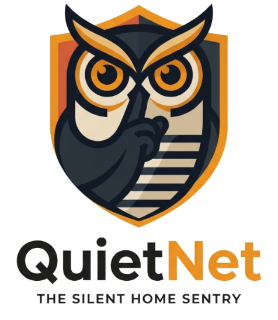

<p align="center"></p>

# QuietNet

A cloud DNS gateway for the home. Every device resolves through an AdGuard Home server on a VM. QuietNet's engine:

* explains which companies each device talks to;
* lets you block them per device;
* finds your TV on the WiFi and points its DNS at QuietNet, or tells you exactly how to do that by hand.

```
 phone / laptop ──DoT/DoH──►┐
 TV (Private DNS / router) ─►│ AdGuard Home (VM) ◄──ssh -L 3000── backend (laptop): FastAPI + SQLite + Gemini
                             └─ per-device $client rules ◄────────┘        │ stdio MCP
                                                                 pahra-companion (LAN scan, ADB)
                                                                 frontend (Vite + React) ──/api──► backend
```

| Folder | What |
|---|---|
| `infra/` | VM setup: AdGuard in Docker, wildcard certificate, init script, SSH tunnel. See [infra/README.md](infra/README.md) |
| `backend/` | The engine. It polls the AdGuard query log, classifies domains, writes suggestion cards and decisions, and syncs rules. The TV assistant is the MCP client plus a Gemini agent or a guided fallback |
| `companion/` | The `pahra-companion` MCP server. It scans the LAN, fingerprints TVs, talks to Android/Fire TVs over ADB, and has setup guides. See [companion/README.md](companion/README.md) |
| `frontend/` | The dashboard: setup wizard, suggestions, devices, alerts, weekly report, settings, and the "Connect my TV" assistant |

## Quick start

After installing once (below), one command opens everything in separate windows:

```powershell
.\scripts\dev.ps1                          # local: fake AdGuard + API + dashboard (no VM needed)
.\scripts\dev.ps1 -Real -VmHost <VM_IP>    # real: SSH tunnel + API (backend\.env) + dashboard
```

* **Setting up the cloud DNS server:** step by step in [infra/README.md](infra/README.md).
* **Presenting:** [DEMO.md](DEMO.md).

## Run locally (no VM needed)

Python dependencies are managed with [Poetry](https://python-poetry.org/) 2 (`pipx install poetry`). Each of `backend/` and `companion/` has its own `pyproject.toml` and committed `poetry.lock`, and `poetry install` makes a `.venv` inside that folder (`poetry.toml`), which the scripts rely on. To change a dependency, run `poetry add <pkg>` or `poetry update <pkg>` and commit both files.

Each block runs in its own terminal.

**Backend:**

```powershell
cd backend
poetry install
copy .env.example .env      # then set ADGUARD_URL=http://127.0.0.1:3100 for the fake
```

**Fake AdGuard.** It generates TV and phone traffic for every device you add:

```powershell
cd backend
poetry run python -m devtools.fake_adguard --port 3100
```

**API.** It spawns the companion automatically if `companion\.venv` exists:

```powershell
cd backend
poetry run uvicorn pahra.main:create_app --factory --port 8000
```

**Companion.** The TV assistant needs it:

```powershell
cd companion
poetry install
winget install Google.PlatformTools   # adb, for Android / Google / Fire TV automation
```

**Dashboard:**

```powershell
cd frontend
npm install
npm run dev                  # http://localhost:5173  (proxies /api to :8000)
```

To try it:

1. Add a device in **Setup**.
2. Within a poll cycle (30 s), cards appear in **Suggestions**.
3. Choose **Block all ads & trackers**. In the fake, that device's queries now return NXDOMAIN.
4. Choose **Undo** to reverse it.

For the real VM, follow [infra/README.md](infra/README.md), run `infra\tunnel.ps1`, and keep `ADGUARD_URL=http://127.0.0.1:3000`.

**Before a demo:** with `GEMINI_API_KEY` set, run `poetry run python -m devtools.prewarm` in `backend`. It caches explanations for the demo devices' domains, so cards never wait on Gemini. It never blocks anything.

## Connect my TV

**Setup → TV** opens the assistant. Describe the TV ("the LG in the living room") and it does the following:

1. Reads the network context: gateway, router brand, and the CGNAT verdict.
2. Scans the WiFi and lets you pick the TV.
3. Pings and probes the TV you picked.
4. **Android TV, Google TV or Fire TV:**
   1. Walks you through turning on ADB, or pairs over Wireless debugging.
   2. Asks before each change.
   3. Creates the QuietNet device and sets Private DNS to `<client-id>.dns.<domain>`.
   4. Waits for the TV's first query in AdGuard and shows **Connected**.
5. **Locked TVs behind CGNAT** (LG webOS, Samsung Tizen), or when ADB is refused:
   1. It offers the **laptop DNS relay** and asks first.
   2. The companion listens on the laptop's WiFi IP:53 and forwards each TV's queries over DoH under that TV's own ClientID.
   3. You type the laptop's IP into the TV's DNS. QuietNet waits for the first query and shows **Connected**.
   4. The relay is restored whenever the backend starts, and stops for a TV when you delete that TV.
   5. The laptop has to stay on.
6. **Everything else** (Roku, Apple TV, the relay declined, or verification failed): it shows a ranked, step-by-step guide that takes CGNAT into account. That means manual DNS on the TV, router DNS, or a hotspot for the demo. The values are filled in, and it says plainly what isn't possible.

**Modes.** It runs as a Gemini function-calling agent when `GEMINI_API_KEY` is set. Otherwise, or if Gemini fails midway, it runs the same playbook deterministically.

**What it never does:**

* Log into routers or TV accounts.
* Run arbitrary shell commands. The companion only allows a fixed list of `adb` commands.
* Scan outside your own RFC 1918 subnet, capped at /22.

**What it sends to Gemini.** Device names, vendors and models. Before anything reaches the model:

* IP and MAC addresses are replaced with handles (`host-3`, `mac-1`).
* The TV's QuietNet hostname and DoH URL are scrubbed.

DNS logs are never sent to the assistant.

Suggestion cards also use Gemini. For those, only the domain name and public clues (list hits, DuckDuckGo tracker data, RDAP) are sent, never which device made the query.

## Tests

```powershell
cd backend;   poetry run pytest -q
cd companion; poetry run pytest -q
cd frontend;  npm run build
```

* The backend suite uses a fake AdGuard (`httpx.ASGITransport`) and an in-process stub of the companion with a scripted Gemini.
* It asserts that every rule carries `$client`, devices are isolated from each other, sync is idempotent, and undo works.
* For the assistant, it covers:
  * the guided and agent flows: a Fire TV ends "connected", an LG gets a guide;
  * declining changes nothing;
  * no IP, MAC or hostname reaches the model.

## Known limits (v1)

* The single-user dashboard uses a bearer token (`API_TOKEN`). The data model is multi-tenant.
* There is no encryption at rest for `pahra.db`. Events are purged after 7 days.
* With the laptop asleep, rules already pushed keep working. New cards, quarantine and auto-mode pause until it wakes.
* Neither the companion's guide steps nor its fingerprint fixtures have been checked on real TVs. See "Not verified on real hardware" in [companion/README.md](companion/README.md).
* Router DNS behind CGNAT cannot identify the home. Use per-device DoT/DoH, the laptop relay for locked TVs, or a hotspot for the demo.
* **TVs on the laptop relay lose DNS while the laptop sleeps or QuietNet is stopped.** Phones and laptops on DoT/DoH don't depend on the laptop.

## Credits

QuietNet is the dashboard and the engine. The DNS that every device talks to runs on open-source software and public services:

| Project | What it does in QuietNet | License |
|---|---|---|
| [AdGuard Home](https://github.com/AdguardTeam/AdGuardHome) | The DNS server on the cloud VM (`adguard/adguardhome` in Docker). It answers every lookup over DoT and DoH, applies the per-device `$client` rules, and keeps the query log the engine reads | GPL-3.0 |
| [Cloudflare 1.1.1.1](https://1.1.1.1) and [Quad9](https://www.quad9.net) | Upstream resolvers, reached over TLS, for lookups that are allowed | Public services |
| [Let's Encrypt](https://letsencrypt.org) and [Certbot](https://github.com/certbot/certbot) | The wildcard certificate behind each device's own DoT/DoH address, issued with the Cloudflare DNS plugin | Certbot: Apache-2.0 |
| [Caddy](https://github.com/caddyserver/caddy) | Optional HTTPS front for DNS-over-HTTPS in `infra/docker-compose.harden.yml` | Apache-2.0 |
| [HaGeZi DNS blocklists](https://github.com/hagezi/dns-blocklists) | Tracker and smart-TV lists used to recognise domains | GPL-3.0 |
| [DuckDuckGo Tracker Radar](https://github.com/duckduckgo/tracker-radar) | Which company owns a tracking domain and what it collects | CC BY-NC-SA 4.0 |
| [Inter and Inter Tight](https://rsms.me/inter/) | Dashboard typefaces by Rasmus Andersson | SIL OFL 1.1 |

The dashboard's Settings page carries the same list.
